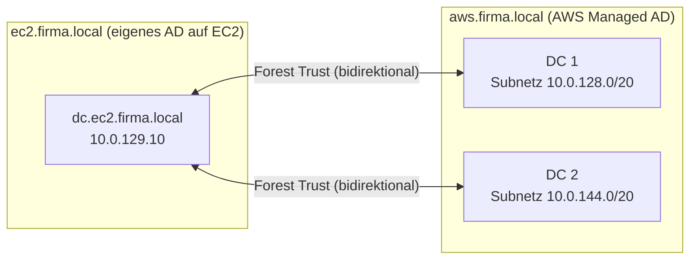

# Dokumentation – AWS Managed Microsoft AD & AD-Trust

Domänen: `ec2.firma.local` (eigenes AD auf EC2) und `aws.firma.local` (AWS Managed Microsoft AD)

## Inhaltsverzeichnis

1. [Einleitung](#1-einleitung)
2. [Umgebung](#2-umgebung)
3. [AWS Managed AD erstellen](#3-aws-managed-ad-erstellen)
4. [Ports und Sicherheitsgruppen](#4-ports-und-sicherheitsgruppen)
5. [Conditional Forwarder](#5-conditional-forwarder)
6. [Trust einrichten](#6-trust-einrichten)
7. [Trust validieren und testen](#7-trust-validieren-und-testen)
8. [Sicherheitsüberlegungen](#8-sicherheitsüberlegungen)
9. [Fazit](#9-fazit)

---

## 1. Einleitung

Diese Dokumentation beschreibt den Aufbau eines **AWS Managed Microsoft AD** und einer **Vertrauensstellung (Trust)** zum eigenen Active Directory auf der EC2-Instanz. Dadurch können Benutzer der einen Domäne auf Ressourcen der anderen Domäne zugreifen, ohne dort ein zweites Konto zu besitzen.

Wichtig: Der Trust ermöglicht nur die **Authentifizierung**. Damit ein Benutzer wirklich auf eine Ressource zugreifen darf, braucht er zusätzlich eine **Berechtigung** (Autorisierung).

> **Kostenhinweis:** AWS Managed AD kostet rund 18 $ pro Woche. Der Auftrag wurde deshalb am Ende des Moduls umgesetzt. Nach der Abnahme wird das Directory wieder gelöscht.



## 2. Umgebung

| Komponente | Wert |
|---|---|
| Eigenes AD (EC2) | `ec2.firma.local`, DC `dc.ec2.firma.local`, `10.0.129.10` |
| AWS Managed AD | `aws.firma.local` (NetBIOS: `AWS`) |
| Edition | [Standard / Enterprise] |
| Subnetz 1 (AWS Managed AD) | `M159-subnet-private1-us-east-1a` (`10.0.128.0/20`) |
| Subnetz 2 (AWS Managed AD) | `M159-subnet-private2-us-east-1b` (`10.0.144.0/20`) |
| DNS-Server des Managed AD | [`10.0.128.x`], [`10.0.144.x`] |
| Admin-Benutzer Managed AD | `admin` |
| Trust-Typ | [Forest Trust] |
| Trust-Richtung | [Zweiseitig (two-way)] |

Passwörter (Admin-Passwort, Trust-Passwort) stehen nicht in dieser Doku, sondern im Setup-Sheet.

## 3. AWS Managed AD erstellen

Im AWS Directory Service wurde ein neues **AWS Managed Microsoft AD** erstellt:

| Schritt | Einstellung |
|---|---|
| 1 | Directory-Typ: *AWS Managed Microsoft AD* |
| 2 | Edition: [Standard] |
| 3 | Directory-DNS-Name: `aws.firma.local`, NetBIOS-Name: `AWS` |
| 4 | Admin-Passwort für den Benutzer `admin` festgelegt und im Setup-Sheet eingetragen |
| 5 | VPC: `M159`-VPC, Subnetze: die beiden privaten Subnetze in zwei Availability Zones |

[Screenshot: Schritt 1–2, Typ und Edition]
[Screenshot: Schritt 3, Domänenname]
[Screenshot: Schritt 4–5, Passwort und Netzwerk]
[Screenshot: Directory mit Status *Active* und den beiden DNS-Adressen]

Die Erstellung dauert einige Minuten. Die beiden DNS-Adressen des Directory wurden im Setup-Sheet eingetragen.

## 4. Ports und Sicherheitsgruppen

Bevor der Trust eingerichtet wird, wurden die Ports aus der Planung nochmals geprüft. Für einen Trust brauchen beide Seiten mehrere Dienste, nicht nur einen:

| Dienst | Port(s) | Zweck |
|---|---|---|
| DNS | 53 (TCP/UDP) | Auffinden der Domain Controller über SRV-Einträge |
| Kerberos | 88 (TCP/UDP) | Authentifizierung |
| RPC Endpoint Mapper | 135 (TCP) | Lokalisieren von RPC-Diensten |
| LDAP | 389 (TCP/UDP) | Verzeichniszugriff |
| SMB | 445 (TCP) | Dateifreigabe, AD-Operationen |
| Kerberos Passwortänderung | 464 (TCP/UDP) | Passwort ändern/setzen |
| LDAPS | 636 (TCP) | Verschlüsseltes LDAP |
| Global Catalog | 3268, 3269 (TCP) | Forest-weite Suche |
| Dynamische RPC-Ports | 49152–65535 (TCP) | RPC nach dem Verbindungsaufbau |
| ICMP | alle | Ping, Diagnose |

**Quelle der Regeln:** Die Ports wurden **nicht** gegen `0.0.0.0/0` geöffnet, sondern nur gegen die Gegenseite:

| Sicherheitsgruppe | Eingehend erlaubt von |
|---|---|
| Sicherheitsgruppe des Domain Controllers (EC2) | `10.0.128.0/20` und `10.0.144.0/20` (Subnetze des Managed AD) |
| Sicherheitsgruppe des Managed AD | `10.0.129.10/32` (Domain Controller auf EC2) |

[Screenshot: Regeln der DC-Sicherheitsgruppe]
[Screenshot: Regeln der Sicherheitsgruppe des Managed AD]

Erreichbarkeit geprüft (vom EC2-DC zu einem DNS-Server des Managed AD):

```powershell
Test-NetConnection -ComputerName [10.0.128.x] -Port 53
Test-NetConnection -ComputerName [10.0.128.x] -Port 88
Test-NetConnection -ComputerName [10.0.128.x] -Port 389
Test-NetConnection -ComputerName [10.0.128.x] -Port 445
```

[Screenshot: Ausgaben mit `TcpTestSucceeded : True`]

## 5. Conditional Forwarder

Normalerweise gehen DNS-Abfragen im eigenen AD an den eigenen DNS-Server. Die Domäne `aws.firma.local` liegt aber ausserhalb von `ec2.firma.local`. Damit der EC2-DC die Domain Controller des Managed AD findet, braucht er eine **bedingte Weiterleitung** (Conditional Forwarder). Ohne Namensauflösung über die Domänengrenze kommt der Trust nicht zustande, weil jede Seite die Domain Controller der anderen über deren SRV-Einträge finden muss.

Auf dem EC2-DC in der DNS-Verwaltung (`dnsmgmt.msc`) unter *Bedingte Weiterleitungen → Neue bedingte Weiterleitung*:

| Feld | Wert |
|---|---|
| DNS-Domäne | `aws.firma.local` |
| IP-Adressen der Master-Server | [`10.0.128.x`], [`10.0.144.x`] (DNS-Adressen des Managed AD) |
| Zone in Active Directory speichern | Aktiviert (Replikation an alle DNS-Server der Domäne) |

[Screenshot: Dialog *Neue bedingte Weiterleitung*]
[Screenshot: Weiterleitung in der DNS-Konsole]

Test:

```powershell
nslookup -type=SOA aws.firma.local
```

[Screenshot: Ausgabe mit dem SOA-Eintrag von `aws.firma.local`]

## 6. Trust einrichten

Ein Trust muss auf **beiden Seiten** eingerichtet werden. Beide Seiten verwenden dasselbe **Trust-Passwort** (im Setup-Sheet hinterlegt).

### 6.1 Seite EC2-AD

In *Active Directory-Domänen und -Vertrauensstellungen* (`domain.msc`) → Eigenschaften der Domäne `ec2.firma.local` → Reiter *Vertrauensstellungen* → *Neue Vertrauensstellung*:

| Schritt | Einstellung |
|---|---|
| 1 | Name der Vertrauensstellung: `aws.firma.local` |
| 2 | Typ: [Gesamtstrukturvertrauensstellung] |
| 3 | Richtung: [Zweiseitig] |
| 4 | Vertrauensstellung erstellen für: [Nur diese Domäne] |
| 5 | Authentifizierungsebene: [Gesamtstrukturweite Authentifizierung] |
| 6 | Trust-Passwort eingegeben |
| 7 | Bestätigung der ausgehenden/eingehenden Vertrauensstellung: [Nein, später] |

[Screenshot: Schritt 1–2]
[Screenshot: Schritt 3–4]
[Screenshot: Schritt 5–6]
[Screenshot: Schritt 7, Zusammenfassung]

### 6.2 Seite AWS Managed AD

In der AWS-Konsole unter *Directory Service → Directory auswählen → Networking & security → Trust relationships → Add trust relationship*:

| Schritt | Einstellung |
|---|---|
| 1 | Trust-Typ: [Forest trust] |
| 2 | Name der Remote-Domäne: `ec2.firma.local` |
| 3 | Trust-Passwort: identisch mit Seite EC2 |
| 4 | Richtung: [Two-way] |
| 5 | Conditional-Forwarder-IP: `10.0.129.10` (EC2-DC) |

[Screenshot: Schritt 1–2]
[Screenshot: Schritt 3–4]
[Screenshot: Schritt 5, Conditional Forwarder]
[Screenshot: Trust mit Status *Verified*]

### 6.3 Richtung des Trusts

Bei einem zweiseitigen Trust vertrauen sich beide Domänen gegenseitig. Benutzer von `aws.firma.local` können sich also an Ressourcen in `ec2.firma.local` ausweisen und umgekehrt. Bei einem einseitigen Trust verläuft die Vertrauensrichtung entgegengesetzt zur Zugriffsrichtung: Die vertrauende Domäne gibt den Benutzern der vertrauten Domäne Zugriff.

## 7. Trust validieren und testen

### 7.1 Validierung

Nachdem beide Seiten eingerichtet sind, wurde der Trust auf dem EC2-AD geprüft: *Eigenschaften der Domäne → Vertrauensstellungen → Eigenschaften des Trusts → Überprüfen*.

[Screenshot: Meldung, dass die Vertrauensstellung aktiv ist]

### 7.2 Funktionstest

Ein angelegter Trust beweist nur, dass er erstellt wurde. Ob er trägt, zeigt ein Zugriffstest mit einem Konto der Gegenseite:

| Nr. | Test | Erwartung | Nachweis |
|---|---|---|---|
| 1 | Im Dialog «Benutzer, Computer oder Gruppen auswählen» auf dem EC2-DC nach einem Benutzer aus `aws.firma.local` suchen | Benutzer der Gegenseite wird gefunden | [Screenshot] |
| 2 | Ordner auf dem EC2-DC freigeben, Benutzer aus `aws.firma.local` berechtigen | Berechtigung kann gesetzt werden | [Screenshot] |
| 3 | Zugriff auf die Freigabe mit diesem Benutzer | Zugriff funktioniert | [Screenshot] |
| 4 | Zugriff mit einem Benutzer der Gegenseite, der **nicht** berechtigt wurde | Zugriff verweigert | [Screenshot] |

Test 4 zeigt den Unterschied zwischen Authentifizierung und Autorisierung: Der Trust erkennt den Benutzer, aber ohne Berechtigung darf er nichts.

## 8. Sicherheitsüberlegungen

| Risiko | Massnahme |
|---|---|
| Verzeichnisdienste sind ein wertvolles Angriffsziel, offene Ports werden automatisiert gescannt | Trust-Ports nur gegen die Subnetze bzw. die IP der Gegenseite geöffnet, nicht gegen `0.0.0.0/0` |
| Managed AD direkt aus dem Internet erreichbar | Managed AD in **privaten** Subnetzen platziert |
| Zu viele offene Ports | Nur die Ports geöffnet, die für den Trust nötig sind, jede Regel hat einen erklärbaren Zweck |
| Schwaches oder unsicher abgelegtes Trust-Passwort | Starkes Passwort, nur im Setup-Sheet hinterlegt, nicht im Repository |
| Zu weitgehende Zugriffe über den Trust | Berechtigungen nur gezielt vergeben, Zugriff nicht pauschal für die ganze Gegenseite |
| Laufende Kosten | Directory nach der Abnahme gelöscht |

## 9. Fazit

Der Trust verbindet zwei eigenständige Domänen, ohne dass die Benutzer zwei Konten brauchen. Damit er zustande kommt, müssen drei Dinge stimmen: Die Namensauflösung über die Domänengrenze (Conditional Forwarder), die Erreichbarkeit der benötigten Ports und das identische Trust-Passwort auf beiden Seiten. Fehler lassen sich meist auf eine dieser drei Ursachen zurückführen.

Beim Managed AD betreibt AWS die Domain Controller, Updates und Verfügbarkeit, dafür gibt es keinen Domänenadministrator-Zugriff auf die DCs. Das eigene AD auf EC2 bietet volle Kontrolle, aber auch die volle Verantwortung. Aus Sicherheitssicht war es wichtig, die Trust-Ports nur gegen die Gegenseite zu öffnen. Ein Trust ersetzt ausserdem keine Berechtigungen: Er regelt nur, wer jemand ist, nicht, was er darf.
