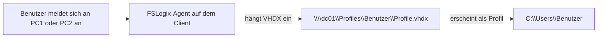
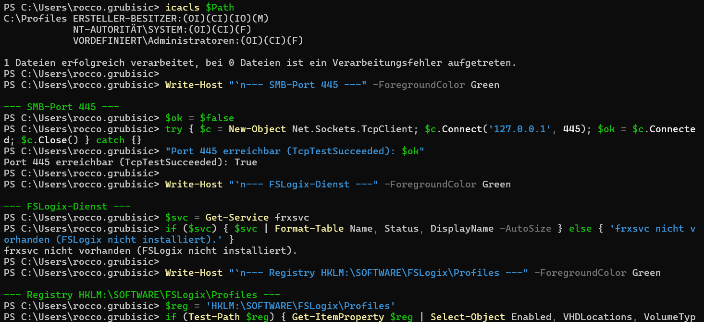

# Dokumentation – Servergespeicherte Benutzerprofile (FSLogix Profile Container)

Domäne: `firma.local`

## Inhaltsverzeichnis

- [Dokumentation – Servergespeicherte Benutzerprofile (FSLogix Profile Container)](#dokumentation--servergespeicherte-benutzerprofile-fslogix-profile-container)
  - [Inhaltsverzeichnis](#inhaltsverzeichnis)
  - [1. Einleitung](#1-einleitung)
  - [2. Umgebung](#2-umgebung)
  - [3. Freigabe vorbereiten](#3-freigabe-vorbereiten)
    - [3.1 Ordner und Freigabe](#31-ordner-und-freigabe)
    - [3.2 Berechtigungen](#32-berechtigungen)
    - [3.3 Begründung](#33-begründung)
  - [4. FSLogix installieren](#4-fslogix-installieren)
    - [4.1 Agent auf beiden Clients](#41-agent-auf-beiden-clients)
    - [4.2 Gruppenrichtlinienvorlagen auf dem Server](#42-gruppenrichtlinienvorlagen-auf-dem-server)
  - [5. FSLogix per Gruppenrichtlinie konfigurieren](#5-fslogix-per-gruppenrichtlinie-konfigurieren)
  - [6. Test](#6-test)
  - [7. Fazit](#7-fazit)

---

## 1. Einleitung

Diese Dokumentation beschreibt die Einrichtung servergespeicherter Benutzerprofile für die fiktive Firma **firma.local**. Bisher nutzten alle Benutzer lokale Profile: Desktop, Dokumente und Einstellungen lagen nur auf dem jeweiligen PC. Neu werden die Profile mit **FSLogix Profile Container** zentral auf einer Dateifreigabe gespeichert.

Das Profil liegt dabei als **VHDX-Container** auf dem Server und wird bei der Anmeldung eingehängt, statt kopiert zu werden. Dadurch findet ein Benutzer an jedem Client dieselbe Umgebung vor.




## 2. Umgebung

| Komponente | Hostname | Rolle |
|---|---|---|
| Server | `dc01.firma.local` | Domain Controller, Dateifreigabe `Profiles` |
| PC1 | `pc01.firma.local` | Windows-Client, Domänenmitglied |
| PC2 | `pc02.firma.local` | Windows-Client, Domänenmitglied |

**Testbenutzer:** `anna.meier` (IT), `peter.keller` (Verkauf)
**OU der Clients:** `OU=Computer,OU=IT,OU=Intern,DC=firma,DC=local` bzw. `OU=Computer,OU=Verkauf,OU=Intern,DC=firma,DC=local`

**Voraussetzungen**

| Voraussetzung | Erfüllt durch |
|---|---|
| Mindestens 2 Testbenutzer im AD | `anna.meier`, `peter.keller` |
| Dateifreigabe für die Profil-Container | `\\dc01\Profiles` (Kapitel 3) |
| Netzwerkzugriff der Clients auf die Freigabe | SMB über Port 445 |

Die Erreichbarkeit der Freigabe wurde von beiden Clients aus geprüft:

```powershell
Test-NetConnection -ComputerName dc01.firma.local -Port 445
```

[Screenshot: Ausgabe mit `TcpTestSucceeded : True` auf PC1 und PC2]

## 3. Freigabe vorbereiten

### 3.1 Ordner und Freigabe

Auf dem Server wurde der Ordner `C:\Profiles` angelegt und als `\\dc01\Profiles` freigegeben:

```powershell
New-Item -Path C:\Profiles -ItemType Directory
New-SmbShare -Name "Profiles" -Path "C:\Profiles" -ChangeAccess "Authenticated Users"
```

### 3.2 Berechtigungen

Jeder Benutzer soll seinen eigenen Container anlegen können, aber keinen Zugriff auf fremde Container haben. Die Freigabe wurde bewusst grosszügig gesetzt, die eigentliche Einschränkung erfolgt über NTFS (gleiches Prinzip wie in Auftrag 04).

**Freigabeberechtigungen**

| Prinzipal | Berechtigung |
|---|---|
| Authentifizierte Benutzer | Ändern |

**NTFS-Berechtigungen auf `C:\Profiles`** (Vererbung deaktiviert, Standardgruppe «Benutzer» entfernt)

| Prinzipal | Berechtigung | Gilt für |
|---|---|---|
| Administratoren | Vollzugriff | Diesen Ordner, Unterordner und Dateien |
| SYSTEM | Vollzugriff | Diesen Ordner, Unterordner und Dateien |
| ERSTELLER-BESITZER (CREATOR OWNER) | Ändern | Nur Unterordner und Dateien |
| `Intern` (Sicherheitsgruppe) | Ordner auflisten / Daten lesen, Ordner erstellen / Daten anfügen | Nur diesen Ordner |

Umsetzung per `icacls`:

```powershell
icacls C:\Profiles /inheritance:r
icacls C:\Profiles /grant "Administrators:(OI)(CI)F"
icacls C:\Profiles /grant "SYSTEM:(OI)(CI)F"
icacls C:\Profiles /grant "CREATOR OWNER:(OI)(CI)(IO)M"
icacls C:\Profiles /grant "FIRMA\Intern:(AD,RD)"
```

[Screenshot: Freigabeberechtigungen von `Profiles`]
[Screenshot: NTFS-Berechtigungen (Sicherheit → Erweitert)]

### 3.3 Begründung

- **Nur diesen Ordner** für die Benutzergruppe: Benutzer dürfen im Stammordner Unterordner anlegen, aber nicht in fremde Ordner hinein.
- **ERSTELLER-BESITZER** erhält Ändern auf Unterordner und Dateien: Wer den Ordner anlegt, ist Besitzer und kann darin arbeiten, andere nicht.
- **Administratoren** behalten Vollzugriff für Wartung und Wiederherstellung.

## 4. FSLogix installieren

### 4.1 Agent auf beiden Clients

FSLogix wurde von Microsoft heruntergeladen. Auf `pc01` und `pc02` wurde `FSLogixAppsSetup.exe` (64 Bit) mit den Standardoptionen installiert und die Clients anschliessend neu gestartet. Die Installation wurde über den Dienst geprüft:

```powershell
Get-Service frxsvc
```

[Screenshot: Installation und Dienststatus auf PC1]
[Screenshot: Installation und Dienststatus auf PC2]

### 4.2 Gruppenrichtlinienvorlagen auf dem Server

Auf dem Server wurden die mitgelieferten Vorlagen kopiert:

| Datei | Zielordner |
|---|---|
| `fslogix.admx` | `C:\Windows\PolicyDefinitions` |
| `fslogix.adml` | `C:\Windows\PolicyDefinitions\en-US` |

Danach erscheint im GPO-Editor unter *Computerkonfiguration → Richtlinien → Administrative Vorlagen* der neue Knoten **FSLogix**.

[Screenshot: kopierte Dateien im Zielordner]

## 5. FSLogix per Gruppenrichtlinie konfigurieren

Für das GPO wird die Namenskonvention aus Auftrag 07 verwendet:

```
GPO_<Geltungsbereich>_<Funktion>
```

- **GPO-Name:** `GPO_Intern_FSLogix-Profile`
- **Verknüpft mit:** OU `Intern` (gilt dadurch für alle Computerkonten darunter, also auch für die Client-OUs der Abteilungen)
- **Konfigurationsbereich:** Computerkonfiguration, da die Einstellungen in `HKLM` liegen

Einstellungen unter *Computerkonfiguration → Richtlinien → Administrative Vorlagen → FSLogix → Profile Containers*:

| Einstellung | Wert | Pflicht |
|---|---|---|
| Enabled | Aktiviert | ja |
| VHD Location | `\\dc01.firma.local\Profiles` | ja |
| Virtual Disk Type | VHDX | empfohlen |
| Swap directory name components | Aktiviert (Ordnername beginnt mit dem Benutzernamen) | empfohlen |

[Screenshot: GPO-Editor mit den Einstellungen]
[Screenshot: Gruppenrichtlinienverwaltung mit der Verknüpfung auf der OU `Intern`]

Auf beiden Clients wurden die Richtlinien aktualisiert und die Clients neu gestartet:

```powershell
gpupdate /force
Restart-Computer
```

Kontrolle, dass die Einstellungen angekommen sind:

```powershell
Get-ItemProperty HKLM:\SOFTWARE\FSLogix\Profiles
```

[Screenshot: Ausgabe mit `Enabled`, `VHDLocations` und `VolumeType`]

Falls die Einstellungen nicht ankommen, hilft `gpresult /r` (Verknüpfung, richtige OU, Computer- statt Benutzerkonfiguration).



## 6. Test

Der Test wurde mit dem Testbenutzer `anna.meier` an beiden Clients durchgeführt. Der Hostname ist auf den Screenshots sichtbar.

| Nr. | Schritt | Erwartung | Nachweis |
|---|---|---|---|
| 1 | Anmeldung von `anna.meier` an PC1 | Anmeldung funktioniert mit einem Profil, nicht temporär | [Screenshot] |
| 2 | Freigabe `\\dc01\Profiles` prüfen | Ordner des Benutzers mit einer `.vhdx`-Datei | [Screenshot] |
| 3 | `VonPC1.txt` auf dem Desktop erstellen, abmelden | Datei angelegt | [Screenshot] |
| 4 | Anmeldung desselben Benutzers an PC2 | `VonPC1.txt` ist vorhanden | [Screenshot] |
| 5 | `VonPC2.txt` auf dem Desktop erstellen, abmelden | Datei angelegt | [Screenshot] |
| 6 | Anmeldung an PC1 | `VonPC1.txt` und `VonPC2.txt` sind vorhanden | [Screenshot] |

**Berechtigungstest:** Mit `peter.keller` wurde versucht, den Container-Ordner von `anna.meier` zu öffnen. Erwartet wird «Zugriff verweigert».

[Screenshot: Zugriff verweigert]

Zusätzlich lässt sich in den FSLogix-Logs unter `C:\ProgramData\FSLogix\Logs` nachvollziehen, dass der Container eingehängt wurde.

## 7. Fazit

Mit FSLogix liegt das gesamte Profil in einer VHDX-Datei auf dem Server und wird bei der Anmeldung eingehängt. Es muss nichts kopiert werden, deshalb sind die Anmeldezeiten kürzer und beschädigte Profile seltener als bei klassischen Roaming Profiles. Die Konfiguration über ein GPO in der Computerkonfiguration verteilt die Einstellungen automatisch an alle Clients einer OU, ohne dass jeder Client einzeln angefasst werden muss.

Wichtig sind die Berechtigungen auf der Freigabe: Mit der Kombination aus «nur diesen Ordner» für die Benutzergruppe und ERSTELLER-BESITZER auf den Unterordnern legt jeder Benutzer seinen Container selbst an, sieht aber keine fremden. Zu beachten bleibt, dass ein Container standardmässig exklusiv eingehängt wird, eine gleichzeitige Anmeldung desselben Benutzers an zwei Clients also kein zweites FSLogix-Profil erhält.
