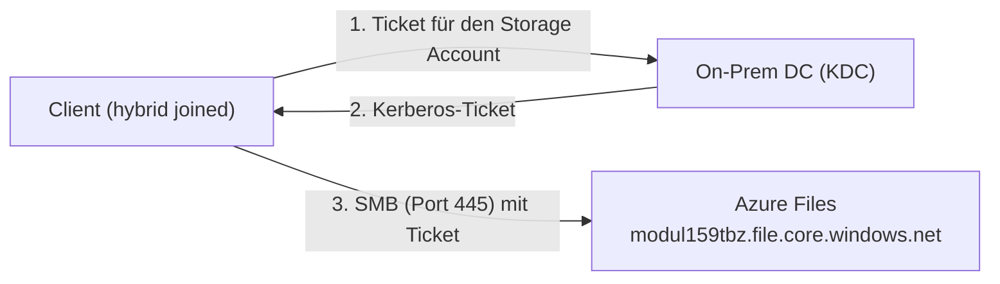

# Dokumentation – Netzlaufwerk zu Azure Files Migration

Domäne: `ec2.firma.local` · Öffentlicher UPN-Suffix: `[m159tbz.v6.rocks]`

## Inhaltsverzeichnis

- [Dokumentation – Netzlaufwerk zu Azure Files Migration](#dokumentation--netzlaufwerk-zu-azure-files-migration)
  - [Inhaltsverzeichnis](#inhaltsverzeichnis)
  - [1. Einleitung](#1-einleitung)
  - [2. Umgebung](#2-umgebung)
  - [3. Wahl der Authentifizierungsvariante](#3-wahl-der-authentifizierungsvariante)
  - [4. Storage Account und Share einrichten](#4-storage-account-und-share-einrichten)
    - [4.1 Storage Account](#41-storage-account)
    - [4.2 Share anlegen](#42-share-anlegen)
    - [4.3 Erreichbarkeit von Port 445](#43-erreichbarkeit-von-port-445)
  - [5. Verbindung mit Storage-Account-Key](#5-verbindung-mit-storage-account-key)
  - [6. AD-DS-Authentifizierung einrichten](#6-ad-ds-authentifizierung-einrichten)
    - [6.1 Zugriff im Azure-Portal konfigurieren](#61-zugriff-im-azure-portal-konfigurieren)
    - [6.2 AzFilesHybrid installieren](#62-azfileshybrid-installieren)
    - [6.3 Storage Account als Computerobjekt ins AD aufnehmen](#63-storage-account-als-computerobjekt-ins-ad-aufnehmen)
  - [7. GPO: Host-Name-to-Kerberos-Realm-Mapping](#7-gpo-host-name-to-kerberos-realm-mapping)
  - [8. Berechtigungen und Rollen auf dem Share](#8-berechtigungen-und-rollen-auf-dem-share)
  - [9. Test](#9-test)
    - [9.1 Voraussetzung: Hybrid Join und SSO](#91-voraussetzung-hybrid-join-und-sso)
    - [9.2 Verbindung und Berechtigungstest](#92-verbindung-und-berechtigungstest)
    - [9.3 Entra Kerberos](#93-entra-kerberos)
  - [10. Fazit](#10-fazit)

---

## 1. Einleitung

Diese Dokumentation beschreibt die Migration eines Netzlaufwerks nach **Azure Files**. Statt eines eigenen File Servers liegt der Share in einem Azure Storage Account. Die Benutzer greifen per SMB (Port 445) darauf zu und melden sich dabei per **Single Sign-On** mit ihrem Domänenkonto an, ohne zusätzliche Passworteingabe.



## 2. Umgebung

| Komponente | Wert |
|---|---|
| Domäne (On-Prem) | `ec2.firma.local` (Kerberos-Realm `EC2.FIRMA.LOCAL`) |
| Domain Controller | `dc.ec2.firma.local` |
| Client | `[client.ec2.firma.local]` (hybrid joined, siehe Auftrag 10) |
| Storage Account | `[modul159tbz]` |
| Share | `[daten]` |
| Ressourcengruppe | `[rg-m159]` |
| Benutzer Sekretariat | `[sekretariat.user@m159tbz.v6.rocks]` |
| Benutzer Buchhaltung | `[buchhaltung.user@m159tbz.v6.rocks]` |

Der Storage-Account-Key und Passwörter stehen nicht in dieser Doku, sondern im Setup-Sheet.

## 3. Wahl der Authentifizierungsvariante

Für Azure Files stehen drei Identity-based-Access-Varianten zur Verfügung:

| Variante | Beurteilung | Entscheid |
|---|---|---|
| **Active Directory Domain Services (AD DS)** | Der On-Prem-DC (KDC) stellt das Kerberos-Ticket aus. Der Storage Account wird dafür als Computerobjekt im lokalen AD registriert (`Join-AzStorageAccount`). | **gewählt** |
| Microsoft Entra Domain Services | Verzeichnis wird in Azure bereitgestellt. Verursacht Zusatzkosten und Aufwand ohne Vorteil im Szenario. | verworfen |
| Microsoft Entra Kerberos | Eleganteste Lösung (Entra stellt die Tickets aus, kein Computerobjekt nötig), funktioniert aber nur von Windows-**Client**-Betriebssystemen. Unsere «Clients» sind Windows-Server-Instanzen auf EC2. | verworfen |

## 4. Storage Account und Share einrichten

### 4.1 Storage Account

Im Azure-Portal wurde ein Speicherkonto erstellt:

| Einstellung | Wert |
|---|---|
| Name | `[modul159tbz]` |
| Region | [z. B. Switzerland North] |
| Leistung / Redundanz | [Standard / LRS] |
| Übrige Einstellungen | Standard |

[Screenshot: Storage Account erstellen]
[Screenshot: Übersicht des Storage Accounts]

### 4.2 Share anlegen

Im Storage Account unter *Datenspeicher → Dateifreigaben → Dateifreigabe* wurde der Share `[daten]` erstellt.

[Screenshot: Share erstellen]
[Screenshot: Share in der Übersicht]

### 4.3 Erreichbarkeit von Port 445

Azure Files nutzt SMB über Port 445. Die Verbindung wurde vom Client geprüft:

```powershell
Test-NetConnection -ComputerName modul159tbz.file.core.windows.net -Port 445
```

[Screenshot: Ausgabe mit `TcpTestSucceeded : True`]

## 5. Verbindung mit Storage-Account-Key

Als erster Nachweis wurde der Share über den Storage-Account-Key verbunden (Zugriff über die Identität des Storage Accounts, nicht über den Benutzer):

```powershell
cmdkey /add:modul159tbz.file.core.windows.net /user:localhost\modul159tbz /pass:<STORAGE-ACCOUNT-KEY>
New-PSDrive -Name Z -PSProvider FileSystem -Root "\\modul159tbz.file.core.windows.net\daten" -Persist
```

[Screenshot: Laufwerk `Z:` im Explorer, Key nicht sichtbar]

Diese Variante braucht keine Identität des Benutzers und gibt vollen Zugriff, sie eignet sich deshalb nur für Tests und Administration. Danach wurde das gespeicherte Laufwerk wieder entfernt, damit der spätere SSO-Test nicht verfälscht wird:

```powershell
Remove-PSDrive -Name Z
cmdkey /delete:modul159tbz.file.core.windows.net
```

## 6. AD-DS-Authentifizierung einrichten

### 6.1 Zugriff im Azure-Portal konfigurieren

Im Storage Account unter *Datenspeicher → Dateifreigaben → Identitätsbasierter Zugriff* wurde **Active Directory** als Quelle gewählt.

[Screenshot: Identitätsbasierter Zugriff, Quelle Active Directory]

### 6.2 AzFilesHybrid installieren

Auf dem Domänen-Server (als Administrator in PowerShell):

```powershell
$downloadPath = "C:\AzFilesHybrid"
New-Item -Path $downloadPath -ItemType Directory -Force
Invoke-WebRequest -Uri "https://github.com/Azure-Samples/azure-files-samples/releases/download/v0.2.3/AzFilesHybrid.zip" -OutFile "$downloadPath\AzFilesHybrid.zip"
Expand-Archive "$downloadPath\AzFilesHybrid.zip" -DestinationPath $downloadPath
Import-Module "$downloadPath\AzFilesHybrid.psd1" -Force
```

Kontrolle, dass die Cmdlets geladen sind:

```powershell
Get-Command -Module AzFilesHybrid
```

[Screenshot: Ausgabe mit den Cmdlets des Moduls]

Falls der Import fehlschlägt: TLS 1.2 erzwingen, NuGet und PowerShellGet aktualisieren, alle PowerShell-Fenster schliessen und die entpackten Dateien mit `Get-ChildItem C:\AzFilesHybrid -Recurse | Unblock-File` entblocken.

### 6.3 Storage Account als Computerobjekt ins AD aufnehmen

```powershell
Connect-AzAccount
Select-AzSubscription -SubscriptionId "<SUBSCRIPTION-ID>"

Join-AzStorageAccount `
    -ResourceGroupName "rg-m159" `
    -StorageAccountName "modul159tbz" `
    -DomainAccountType ComputerAccount `
    -OrganizationalUnitDistinguishedName "OU=Computer,OU=IT,OU=Intern,DC=ec2,DC=firma,DC=local"
```

Resource-Group, Name und OU sind durch die eigenen Werte zu ersetzen. `Join-AzStorageAccount` legt im lokalen AD ein Computerobjekt für den Storage Account an. Erst dadurch kann der lokale KDC ein Kerberos-Ticket für den Zugriff auf den Share ausstellen.

Verifikation, dass das Objekt im AD existiert und die Konfiguration im Storage Account aktiv ist:

```powershell
Get-ADComputer -Identity modul159tbz
Debug-AzStorageAccountAuth -StorageAccountName "modul159tbz" -ResourceGroupName "rg-m159" -Verbose
```

[Screenshot: Prüfung der PS-Befehle / Connect-AzAccount]
[Screenshot: Ausgabe von `Join-AzStorageAccount`]
[Screenshot: Computerobjekt in `dsa.msc`]
[Screenshot: Azure-Portal mit aktivierter AD-Authentifizierung]

## 7. GPO: Host-Name-to-Kerberos-Realm-Mapping

**Hintergrund:** Der Benutzer meldet sich mit dem Custom-UPN an, Kerberos verwendet aber immer den Realm der lokalen AD-Domäne. Ohne Mapping würde der Client den Hostnamen `modul159tbz.file.core.windows.net` einem falschen Realm zuordnen, und der KDC fände kein passendes Computerkonto.

| Eigenschaft | Wert |
|---|---|
| GPO-Name | `GPO_Intern_Kerberos-Realm-Mapping` |
| Verknüpft mit | OU `Intern` (Computerkonten der Clients) |
| Pfad | Computerkonfiguration → Richtlinien → Administrative Vorlagen → System → Kerberos → **Define host name-to-Kerberos realm mappings** |
| Einstellung | Aktiviert |
| Wertname (Realm) | `EC2.FIRMA.LOCAL` |
| Wert (Hostname-Suffix) | `.file.core.windows.net` |

[Screenshot: GPO-Einstellung mit dem Mapping]
[Screenshot: Verknüpfung in der Gruppenrichtlinienverwaltung]

Auf dem Client angewendet:

```powershell
gpupdate /force
```

## 8. Berechtigungen und Rollen auf dem Share

Der Zugriff wird auf zwei Ebenen gesteuert:

| Ebene | Mechanismus | Wirkung |
|---|---|---|
| Share | Azure-RBAC-Rollen | Wer darf auf dem Share lesen bzw. schreiben |
| Datei/Ordner | NTFS-Berechtigungen | Wer darf innerhalb des Shares was |

Beide greifen zusammen, das Restriktivere gewinnt. Zugewiesen wurden die Rollen nach dem Prinzip der geringsten Rechte:

| Abteilung | Benutzer | Rolle | Zugriff |
|---|---|---|---|
| Sekretariat | `[sekretariat.user]` | Storage File Data SMB Share **Reader** | Lesen |
| Buchhaltung | `[buchhaltung.user]` | Storage File Data SMB Share **Contributor** | Lesen und Schreiben |

Die Zuweisung erfolgt im Azure-Portal unter *Share → Zugriffskontrolle (IAM) → Rollenzuweisung hinzufügen*. Die Benutzer müssen dafür in Entra ID vorhanden sein, also über Entra Connect aus dem lokalen AD synchronisiert (Auftrag 10).

[Screenshot: Rollenzuweisung Sekretariat]
[Screenshot: Rollenzuweisung Buchhaltung]

## 9. Test

### 9.1 Voraussetzung: Hybrid Join und SSO

Auf dem Client wurde der Gerätestatus geprüft:

```powershell
dsregcmd /status
```

Erwartet im Bereich *Device State* `AzureAdJoined : YES` und `DomainJoined : YES`, im Bereich *SSO State* ein vorhandenes Primary Refresh Token.

[Screenshot: Ausgabe von `dsregcmd /status`]

### 9.2 Verbindung und Berechtigungstest

Die Verbindung erfolgte ohne Angabe von Benutzername oder Passwort:

```powershell
New-PSDrive -Name Z -PSProvider FileSystem -Root "\\modul159tbz.file.core.windows.net\daten" -Persist
```

| Nr. | Test | Erwartung | Nachweis |
|---|---|---|---|
| 1 | Anmeldung als Sekretariat-Benutzer, Share verbinden | Verbindung ohne Passwortabfrage | [Screenshot] |
| 2 | Sekretariat: Datei öffnen / lesen | Funktioniert | [Screenshot] |
| 3 | Sekretariat: Datei erstellen | Zugriff verweigert | [Screenshot] |
| 4 | Anmeldung als Buchhaltung-Benutzer, Share verbinden | Verbindung ohne Passwortabfrage | [Screenshot] |
| 5 | Buchhaltung: Datei erstellen und ändern | Funktioniert | [Screenshot] |

Mit `klist` lässt sich zusätzlich prüfen, dass ein Kerberos-Ticket für den Storage Account ausgestellt wurde.

[Screenshot: Ausgabe von `klist`]

### 9.3 Entra Kerberos

Die Variante *Microsoft Entra Kerberos* ist im Portal sichtbar, aber **nicht aktiviert**: Sie funktioniert nur mit Windows-Client-Betriebssystemen (Windows 10/11), nicht mit den Windows-Server-Instanzen der Umgebung.

## 10. Fazit

Mit der AD-DS-Variante bleibt der lokale DC für die Authentifizierung zuständig: Der Storage Account erscheint als Computerobjekt im AD, der KDC stellt das Ticket aus, und der Benutzer kommt ohne zusätzliche Anmeldung auf den Share. Dafür sind drei Teile nötig, die zusammenpassen müssen: die Registrierung des Storage Accounts im AD, das Realm-Mapping per GPO und die Synchronisation der Benutzer nach Entra ID, damit die RBAC-Rollen zugewiesen werden können.

Die Zugriffssteuerung läuft auf zwei Ebenen. Die RBAC-Rollen regeln den Zugriff auf Share-Ebene, die NTFS-Berechtigungen innerhalb des Shares. Ein Zugriff über den Storage-Account-Key umgeht diese Identitätsprüfung und ist deshalb nur für Tests und Administration geeignet. Der Vorteil gegenüber einem eigenen File Server ist, dass Betrieb, Skalierung und Backup des Speichers bei Azure liegen. Dafür hängt der Zugriff von der Erreichbarkeit von Azure und von Port 445 ab.
