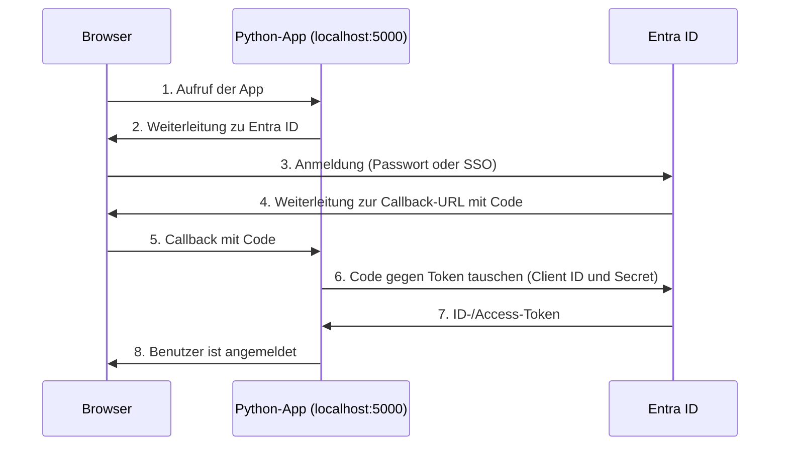

# Dokumentation – SSO Python App (Entra ID)

Domäne: `ec2.firma.local` · Öffentlicher UPN-Suffix: `[m159tbz.v6.rocks]`

## Inhaltsverzeichnis

- [Dokumentation – SSO Python App (Entra ID)](#dokumentation--sso-python-app-entra-id)
  - [Inhaltsverzeichnis](#inhaltsverzeichnis)
  - [1. Einleitung](#1-einleitung)
  - [2. Umgebung](#2-umgebung)
  - [3. Python-App starten](#3-python-app-starten)
  - [4. App in Entra ID registrieren](#4-app-in-entra-id-registrieren)
  - [5. Konfiguration der App](#5-konfiguration-der-app)
  - [6. Login-Test 1: Chrome mit manueller Anmeldung](#6-login-test-1-chrome-mit-manueller-anmeldung)
  - [7. Login-Test 2: Chrome mit token-basiertem SSO](#7-login-test-2-chrome-mit-token-basiertem-sso)
  - [8. Login-Test 3: Edge mit Kerberos-/WIA-SSO](#8-login-test-3-edge-mit-kerberos-wia-sso)
  - [9. Probleme und Lösungen](#9-probleme-und-lösungen)
  - [10. Fazit](#10-fazit)

---

## 1. Einleitung

Diese Dokumentation beschreibt, wie eine Python-Webanwendung (Flask) an **Microsoft Entra ID** als Identity Provider angebunden wird. Die App verwaltet keine Passwörter selbst: Sie leitet den Benutzer zu Entra ID weiter, erhält nach dem Login ein Token und kennt damit die Identität des Benutzers, ohne das Passwort je zu sehen (OpenID Connect / OAuth 2.0).

Getestet werden drei Szenarien:

| Test | Browser | Art der Anmeldung |
|---|---|---|
| 1 | Chrome (Inkognito) | Manuell, Passwort wird eingegeben |
| 2 | Chrome | Token-basiertes SSO, bereits bei Entra ID angemeldet |
| 3 | Edge | Klassisches Kerberos-/WIA-SSO über die Windows-Anmeldung |



## 2. Umgebung

| Komponente | Wert |
|---|---|
| Server / Client für die App | `[Hostname]` (Windows Server auf EC2) |
| Python-Version | [3.12.x] |
| Framework | Flask, Authlib, python-dotenv |
| Entra-ID-Tenant | `[Tenant-Name]` |
| Redirect-URI | `http://localhost:5000[/Callback-Pfad der App]` |
| Test-Benutzer (SSO) | `[sso.user@m159tbz.v6.rocks]` (unter dem **öffentlichen UPN** erstellt) |

Directory (tenant) ID, Application (client) ID und Client Secret stehen nicht in dieser Doku, sondern im Setup-Sheet (Kapitel 9).

## 3. Python-App starten

Python wurde per PowerShell installiert (alternativ über python.org mit der Option «Add Python to PATH»):

```powershell
Invoke-WebRequest -Uri "https://www.python.org/ftp/python/3.12.1/python-3.12.1-amd64.exe" -OutFile "python-installer.exe"
Start-Process -FilePath ".\python-installer.exe" -ArgumentList "/quiet InstallAllUsers=1 PrependPath=1" -Wait
```

Nach dem Neustart der PowerShell wurde die Version geprüft und die App in einer virtuellen Umgebung vorbereitet:

```powershell
python --version
cd Pfad\zu\sso-python-app
python -m venv venv
venv\Scripts\Activate
pip install -r requirements.txt
```

Ohne `requirements.txt` hätten die Pakete manuell installiert werden müssen: `pip install flask authlib python-dotenv`.

[Screenshot: `python --version`]
[Screenshot: aktivierte virtuelle Umgebung mit `(venv)` und installierte Pakete]

Die App wurde gestartet:

```powershell
set FLASK_APP=app.py
flask run
```

Die App läuft danach auf `http://localhost:5000`. Wichtig: Flask meldet zwar `127.0.0.1:5000`, aufgerufen wird die App aber über `localhost` (siehe Kapitel 9).

[Screenshot: gestartete App in der PowerShell]

## 4. App in Entra ID registrieren

Im Entra-Portal unter *App-Registrierungen → Neue Registrierung*:

| Schritt | Einstellung |
|---|---|
| 1 | Name der App: `[SSO-Python-App]` |
| 2 | Unterstützte Kontotypen: [Nur Konten in diesem Organisationsverzeichnis] |
| 3 | Redirect-URI (Plattform *Web*): `http://localhost:5000[/Callback-Pfad]` |
| 4 | Unter *Zertifikate & Geheimnisse* ein **Client Secret** erstellt und sofort im Setup-Sheet gespeichert, weil es später nicht mehr angezeigt wird |

Die Werte *Directory (tenant) ID* und *Application (client) ID* stehen auf der Übersichtsseite der App-Registrierung.

[Screenshot: App-Registrierung mit Redirect-URI]
[Screenshot: Übersicht mit Client ID und Tenant ID (IDs teilweise unkenntlich machen)]
[Screenshot: Client Secret erstellt (Wert unkenntlich machen)]

| Wert | Zweck | Vertraulich |
|---|---|---|
| Application (client) ID | Identifiziert die App gegenüber Entra ID | nein |
| Directory (tenant) ID | Bezeichnet das Verzeichnis | nein, aber nicht öffentlich teilen |
| Client Secret | Authentifiziert die App gegenüber Entra ID | **ja** |

## 5. Konfiguration der App

Die Werte wurden in der Datei `.env` im Projektordner eingetragen:

```
[Name der Variable für Client ID]=<CLIENT-ID>
[Name der Variable für Client Secret]=<CLIENT-SECRET>
[Name der Variable für Tenant ID]=<TENANT-ID>
```

Die Variablennamen sind diejenigen, die die App in der mitgelieferten `.env`-Vorlage vorgibt.

**Schutz des Secrets:** Die Datei `.env` gehört nicht ins Git-Repository. Sie wurde in `.gitignore` eingetragen:

```
.env
venv/
```

Kontrolle, dass die Datei nicht versioniert wird:

```powershell
git status
```

[Screenshot: `.env` mit unkenntlich gemachten Werten]
[Screenshot: `.gitignore` und `git status` ohne `.env`]

## 6. Login-Test 1: Chrome mit manueller Anmeldung

Die App wurde in Chrome im **Inkognito-Fenster** über `http://localhost:5000` aufgerufen und die Anmeldung bei Entra ID mit Benutzername und Passwort durchgeführt. Anschliessend wurden die angeforderten Berechtigungen akzeptiert.

| Schritt | Erwartung | Nachweis |
|---|---|---|
| App über `http://localhost:5000` aufrufen | Weiterleitung zu Entra ID | [Screenshot] |
| Anmeldung mit Benutzername und Passwort | Passwort wird eingegeben | [Screenshot] |
| Berechtigungen akzeptieren | Zustimmungsdialog | [Screenshot] |
| Rückkehr zur App | Erfolgreicher Login, Identität des Benutzers sichtbar | [Screenshot] |

## 7. Login-Test 2: Chrome mit token-basiertem SSO

Dieses Szenario wurde mit einem Client getestet, der **kein Mitglied** des EC2-Active-Directory oder von Entra ID ist. Die Anmeldung basiert allein auf der bestehenden Sitzung bei Entra ID im Browser.

| Schritt | Erwartung | Nachweis |
|---|---|---|
| App starten, aber noch nicht aufrufen | App läuft auf `localhost:5000` | [Screenshot] |
| Im selben Browser bei `https://m365.cloud.microsoft/` mit einem Entra-ID-Benutzer anmelden | Anmeldung bei Microsoft 365 | [Screenshot] |
| App über `http://localhost:5000` aufrufen | Login **ohne Passwortabfrage** | **[Video]** |
| Erfolgreicher Login in der App | Identität sichtbar | [Screenshot] |

Entra ID erkennt den Benutzer an der bestehenden Browser-Sitzung (Session-Cookie) und stellt direkt ein Token für die App aus.

## 8. Login-Test 3: Edge mit Kerberos-/WIA-SSO

Dieses Szenario wurde auf einem **hybrid-joined** Client getestet (Auftrag 10). Der Browser nutzt die bestehende Windows-Anmeldung, es erscheint kein Anmeldefenster.

Voraussetzungen:

| Voraussetzung | Prüfung |
|---|---|
| Client ist domain- und hybrid-joined | `dsregcmd /status` zeigt `DomainJoined : YES` und `AzureAdJoined : YES` |
| Benutzer wurde unter dem **öffentlichen UPN** angelegt | UPN `[sso.user@m159tbz.v6.rocks]` in `dsa.msc` |
| Benutzer ist nach Entra ID synchronisiert | Sichtbar im Entra-Portal (Auftrag 10) |

| Schritt | Erwartung | Nachweis |
|---|---|---|
| Anmeldung am Client mit dem SSO-Benutzer | Windows-Anmeldung | [Screenshot] |
| In Edge `https://m365.cloud.microsoft/` öffnen | Öffnet **ohne Passwortabfrage** | [Screenshot] |
| App über `http://localhost:5000` aufrufen | Login **ohne Passwortabfrage** | **[Video]** |
| Erfolgreicher Login in der App | Identität sichtbar | [Screenshot] |

[Screenshot: Ausgabe `dsregcmd /status`]

**Videonachweis:** SSO lässt sich über Screenshots schlecht belegen. Deshalb wurde für Test 2 und 3 je ein Video aufgenommen, auf dem zu sehen ist, dass **kein Passwort-Prompt** erscheint und dass es die eigene Umgebung ist (Hostname sichtbar). Die Videos liegen im Repository.

## 9. Probleme und Lösungen

| Problem | Ursache | Lösung |
|---|---|---|
| Fehler «Redirect URI Mismatch» | Die App wurde über `http://127.0.0.1:5000` aufgerufen, in Entra ID ist aber `http://localhost:5000` registriert. Die beiden Adressen gelten als verschiedene URIs. | App über `http://localhost:5000` aufrufen |
| [weitere] | [Ursache] | [Lösung] |

Nur ausfüllen, was wirklich aufgetreten ist.

## 10. Fazit

Die App prüft keine Passwörter selbst. Sie vertraut dem Identity Provider Entra ID und wertet das zurückgegebene Token aus. Client ID und Tenant ID identifizieren App und Verzeichnis, das Client Secret authentifiziert die App und gehört deshalb in die `.env` und nicht ins Repository. Die registrierte Redirect-URI muss exakt mit der aufgerufenen Adresse übereinstimmen, sonst wird der Login abgelehnt. Das schützt davor, dass Tokens an fremde Ziele umgeleitet werden.

Die drei Tests zeigen drei Wege zum selben Ergebnis: Bei der manuellen Anmeldung gibt der Benutzer sein Passwort ein, beim token-basierten SSO nutzt der Browser die bestehende Entra-ID-Sitzung, und beim Kerberos-/WIA-SSO dient die Windows-Anmeldung des hybrid-joined Clients als Identität. OIDC läuft über HTTP mit einem Identity Provider und funktioniert deshalb auch für Web-Apps ausserhalb des Firmennetzes. Kerberos braucht dagegen Zugang zum Domain Controller und eignet sich vor allem für interne Anwendungen.
